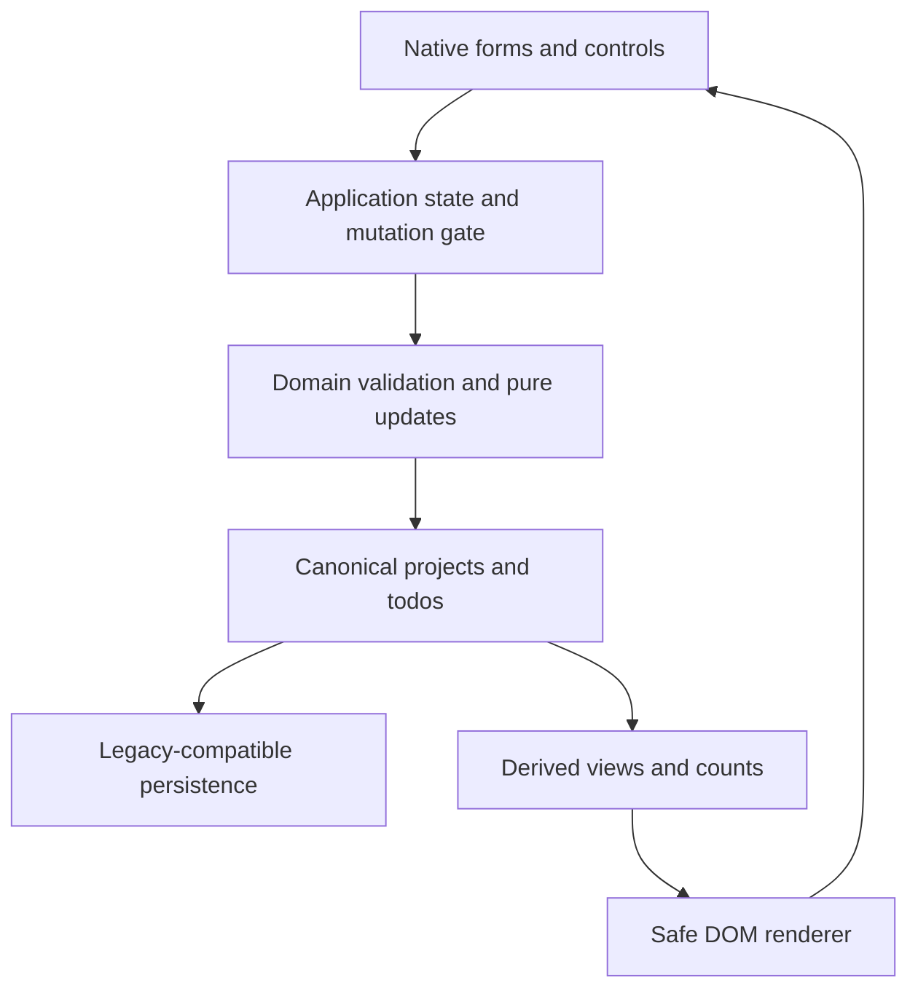
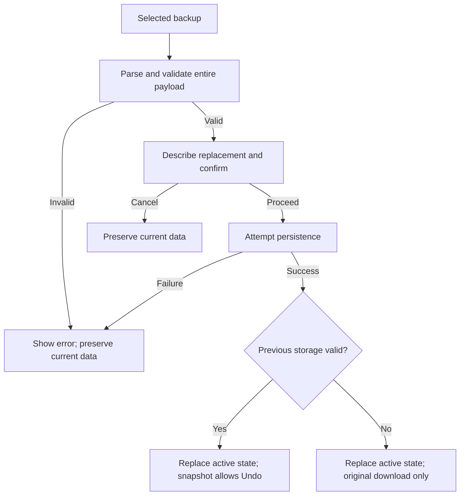

# Ledger 2.0 - Plan

## Goal Capsule

- **Objective:** People can capture, organize, review, and finish their daily work in Ledger with confidence that their existing tasks remain available.
- **Means:** Extend the current vanilla JavaScript workspace through the responsibilities in KTD1–KTD7.
- **Authority:** The approved release scope and Product Contract govern behavior; Planning Contract governs implementation choices.
- **Execution profile:** Implement and verify locally. Shipping, deployment, and opening a PR require separate user authorization.
- **Stop conditions:** Stop for a demonstrated data-loss risk that cannot be corrected within this contract, or a consequential scope change requiring the user.
- **Tail ownership:** The implementing agent owns review fixes, bounded browser verification, accurate README updates, and the final engineering handoff.

---

## Product Contract

### Summary

Turn Ledger into a useful daily workspace while preserving its cream paper, ink, moss, serif headings, and ruled entries. Deliver every P0/P1 feature plus Daily Brief, a seven-day overview, and lightweight Focus Mode. Keep task capture immediate and advanced controls available on demand.

### Problem Frame

The current app only shows one project at a time, puts a full capture form below its task list, and edits priority alone. Users cannot review work across projects, recover destructive actions, or back up their ledger from the interface. Persisted records also lack structural validation, making malformed local data a reliability risk.

### Requirements

**Workspace and task management**

- R1. Preserve task creation, notes, due dates, priority, completion/reopening, project creation/deletion, and reload persistence.
- R2. Provide title-first quick capture with contextual project defaults, optional expanded fields, inline validation, and preserved input after errors.
- R3. Edit title, notes, due date, priority, and project in a prefilled editor with Save and Cancel; moving a task preserves its ID and exactly one owner.
- R4. Provide Today, Upcoming, All Tasks, Completed, and project destinations without persisting duplicate entities. Today contains incomplete overdue/today tasks; Upcoming contains incomplete future tasks; undated tasks remain in All Tasks and projects.
- R5. Search titles and descriptions case-insensitively, combine priority/completion/project/due filters, sort by due date/priority/title/entry order, and provide a clear reset and useful no-results state.
- R6. Create and rename projects with trimmed, nonempty, case-insensitively unique names; show useful open-task counts and protect deletion with explicit affected-task wording. Deleting the final project creates a usable Default project.
- R7. Undo task deletion, completion changes, and project deletion with one recoverable action. Recovery lasts until the next successful data mutation, explicit dismissal, or reload; the interface states that lifetime.

**Reliability and preferences**

- R8. Retain compatibility with `todo-projects` and preserve existing IDs and user text. Missing optional fields receive safe defaults; unusable or unreadable stored data must not be silently overwritten.
- R9. Export a versioned JSON backup and validate an import fully before offering confirmed replacement. Invalid/unsupported/oversized files leave existing data intact; persistence failure must not be presented as a successful restore.
- R10. Treat date-only values as local calendar dates, validate real dates, and classify overdue/today/future/undated consistently across views, counts, and sorting.
- R11. Support persistent Light, Dark, and System appearance with an early theme decision and warm, accessible tokens in both palettes.
- R12. Provide N for capture, / for search, Escape for dismiss/cancel, and Ctrl/Cmd+Z for available application undo; skip global shortcuts in editable controls and expose a shortcuts reference.

**Daily review and quality**

- R13. Show a concise Today Daily Brief derived from actual task state and local time. Counts must state what they measure and must not imply historical completion information absent from legacy records.
- R14. Provide a compact seven-day workload overview whose selected day reveals its due tasks, plus a single-task Focus Mode with notes, completion, and an easy exit.
- R15. Preserve Ledger's editorial identity with semantic tokens, restrained motion, visible focus, semantic forms/dialogs, meaningful status text, touch-friendly actions, and intentional layouts around 375px, 768px, and 1440px.
- R16. Ship a successful build, meaningful automated regression coverage, bounded real-browser inspection when available, an accurate README, and an honest handoff of verification and limitations.

### Key Decisions

- **Direct implementation with the agreed release scope.** The user explicitly approved all P0/P1 features and the three selected differentiators; no prototype gate remains. Governs R1–R16.
- **Retain the Ledger visual world.** The user specified its palette and editorial identity, so implementation develops that direction rather than replacing the brand. Governs R11, R15.

### Scope Boundaries

**Deferred for later:** Subtasks, recurring tasks, drag-and-drop ordering, reminders, PWA installation, timers, productivity scoring, and historical analytics.

**Outside this release:** Framework migration, backend services, authentication, cloud sync, AI features, and account systems.

### Acceptance Examples

- AE1. Covers R2, R3. A user saves a title-only task, edits every field and its project, then cancels another edit; the saved task retains its ID and canceled text never reaches state.
- AE2. Covers R4, R10. Yesterday's incomplete task appears in Today's overdue section; tomorrow's appears in Upcoming; an undated task stays accessible in All Tasks and its project.
- AE3. Covers R7. Delete a project, then Undo before another mutation; the original project and tasks return once, with no extra Default project. A subsequent mutation removes the earlier undo opportunity.
- AE4. Covers R8, R9. Loading malformed stored JSON does not replace it with an empty ledger. Importing invalid JSON or canceling a valid replacement leaves current tasks unchanged.
- AE5. Covers R11, R12, R15. A keyboard user opens and cancels the editor, returns to a sensible control, changes theme, and continues typing N or / in task notes without triggering a global action.

---

## Planning Contract

### Source-grounded baseline audit

These findings describe the checkout before implementation; they are not claims of completed visual/browser verification.

| Finding | Impact | Improvement and benefit | Risk |
|---|---|---|---|
| `src/index.js` only routes by `activeId`; `src/ui.js` renders one project | High: no cross-project review | Derived smart views make daily work visible | Medium: ownership must remain separate from views |
| `src/ui.js` exposes a priority-only editor | High: task corrections require recreation | Full dialog editor preserves task identity | Medium: validate moves atomically |
| `src/template.html` puts all capture fields after the list | Medium: capture becomes harder as lists grow | Title-first capture near workspace heading | Low: preserve drafts during redraws |
| `src/storage.js` returns `[]` after parse failure; startup saves Default for an empty result | High: unreadable data can be overwritten | Distinguish empty/new storage from recovery/error state | High: characterize legacy loading first |
| `localStorage.getItem` is outside the load try/catch; save results are ignored by callers | High: denied storage can crash or hide failed saves | Catch reads/writes and expose a persistent save/recovery warning | Medium: roll back failed writes and preserve form drafts |
| `src/todo.js` validates title and priority but not dates or loaded structures | High: malformed records reach renderer assumptions | Separate tolerant legacy normalization from strict mutation/import validation | Medium: never silently drop existing tasks |
| `draw()` recreates task/project controls after mutations | Medium: keyboard focus and open details can disappear | Stable shell, delegated listeners, explicit focus restoration | Medium: avoid duplicate event handlers |
| No test script exists in `package.json`; Webpack explicitly uses development mode | High: no automated regression gate; build claim is inaccurate | Node tests and an explicit production build | Low: no new runtime framework needed |

### Key Technical Decisions

- KTD1. **Keep the existing stack and real responsibility boundaries.** `src/todo.js` and `src/project.js` retain domain rules; new `src/views.js` owns pure date/filter/view derivation; `src/store.js` owns canonical state, guarded mutations, and Undo; `src/storage.js` owns persistence; `src/ui.js` owns DOM rendering; `src/app.js` owns controller wiring; `src/index.js` boots the app and CSS. This keeps R1–R10 testable without a framework.
- KTD2. **Retain project-owned `todos` arrays.** Persist the existing array at `todo-projects`; a versioned export envelope wraps it without changing legacy ownership. Smart views hold references plus project context, and entry order derives from stable persisted array order rather than invented creation dates. Governs R4, R5, R8, R9.
- KTD3. **Use one guarded mutation path.** Validate a candidate change, capture the previous project snapshot for supported undo, apply once, attempt persistence, then update the view and feedback. A successful Undo consumes its snapshot; a failed persistence attempt leaves Undo available for retry. Every later successful data mutation invalidates the earlier snapshot. Governs R3, R6, R7.
- KTD4. **Keep recovery distinct from an empty ledger.** Storage reads return enough status to distinguish missing data, valid empty data, malformed data, and denied access. Preserve malformed raw data and block automatic replacement; offer its download and intentional replacement. Failed writes roll canonical state back atomically, preserve form drafts, and show a persistent warning; export remains available for committed data. A backup import only replaces active state after a successful save. Imports retain one-level Undo when previous storage was valid; recovery imports cannot Undo an unparseable original. Governs R8, R9.
- KTD5. **Use native controls and modal dialogs.** The task editor, project actions, data tools, and shortcut reference use labeled native forms and `<dialog>` where modal interaction helps. Explicit Save/Cancel and restoration to the invoking control or stable fallback satisfy R2, R3, R6, R9, R12, R15. Native modal interaction provides outside-document inertness; verify focus behavior in the rendered app. See [HTML dialog](https://html.spec.whatwg.org/multipage/interactive-elements.html#the-dialog-element).
- KTD6. **Share calendar classification and deterministic view derivation.** Strict date-only parsing and local-day keys drive grouping, filters, the Daily Brief, and seven-day selection. Due-date sorting places undated tasks last and resolves ties consistently; current completion counts remain distinct from completion history. Governs R4, R5, R10, R13, R14.
- KTD7. **Use built-in Node tests and a small browser verification pass.** Pure modules and injected/fake storage support Node tests; a development-only `jsdom` dependency permits meaningful controller integration tests without a runtime UI framework. Keep a stable shell to avoid caret loss during search and capture. Support both `prefers-color-scheme` and `prefers-reduced-motion`; install no runtime UI dependency. Governs R11, R12, R15, R16.

### Data contract

Projects keep `id`, `name`, and `todos`; tasks keep `id`, `title`, `description`, `dueDate`, `priority`, and `completed`. Empty notes/date default to empty strings, missing priority to medium, and missing completion to false. Missing IDs may be assigned during legacy normalization; duplicate or structurally invalid records enter recovery rather than being silently discarded. Normalization must not trim away or truncate existing user content.

Imports accept the recognized versioned export envelope and legacy project arrays. Reject unsupported versions, invalid field types/values, duplicate IDs, invalid dates, unsafe object keys, and files exceeding a documented size bound. Construct known fields explicitly rather than merging untrusted objects. Render task/project text with text APIs. Storage access itself can fail, so catch property access as well as methods; see the [HTML storage contract](https://html.spec.whatwg.org/multipage/webstorage.html#dom-localstorage-dev).

### High-Level Technical Design

```mermaid
stateDiagram-v2
  [*] --> NoUndo
  NoUndo --> Recoverable: Supported mutation captures snapshot
  Recoverable --> Recoverable: Another supported mutation replaces snapshot
  Recoverable --> NoUndo: Other successful data mutation or dismissal or reload
  Recoverable --> Recoverable: Undo persistence fails; retry remains available
  Recoverable --> NoUndo: Successful Undo consumes and restores snapshot
```

### Assumptions

- Smart-view capture defaults to the current project when available, otherwise the first project; Today capture may default its due date to today and must expose that choice.
- All Tasks includes open and complete tasks unless filtered; Completed remains the explicit completed-only destination.
- The Daily Brief may report current completed tasks with an accurate label; no historical completion timestamp is required for this release.
- A seven-day overview starts with today and shows incomplete due-task workload; selecting a day filters that overview's task list without changing task ownership.
- Multiple-tab live merging is deferred. Any detected external storage change must avoid silently overwriting newer data and provide a reload/recovery path.

### Risks and mitigations

- **Legacy data loss:** Put migration/recovery characterization in U1 before changing rendering and verify no automatic write follows a failed load.
- **Full redraw focus loss:** Preserve the capture/search shell, use delegated listeners, and restore row focus after changes that remove its source element.
- **Date drift:** Never classify with UTC parsing of a date-only string; cover leap days and local boundaries.
- **Broad release scope:** Complete data/task guarantees before differentiators; leave deferred features out rather than weakening accepted ones.
- **Storage failure:** Roll canonical state back atomically, preserve the failed form draft, show a persistent warning, and keep export of committed data available. Failed Undo remains retryable.

---

## Implementation Units

### U1. Establish domain and persistence safeguards

**Goal:** Make state transitions, legacy loading, and import validation safe and testable.

**Requirements:** R1, R3, R6–R10; KTD1–KTD4, KTD6.

**Dependencies:** None.

**Files:** `src/todo.js`, `src/project.js`, `src/views.js`, `src/store.js`, `src/storage.js`, `tests/domain.test.js`, `tests/storage.test.js`, `tests/store.test.js`, `package.json`.

**Approach:** Add pure domain operations and a storage adapter around the retained shape. Establish characterization tests before replacing old storage behavior. Keep normalization and strict import validation separate.

**Patterns to follow:** Existing stable IDs and `project.todos` membership; current storage key.

**Test scenarios:**

- Create/edit a valid task, move it, and verify one task with the same ID in the destination.
- Reject whitespace titles, invalid priorities, duplicate project names, and impossible calendar dates without partial mutation.
- Load a legacy array with missing optional fields and verify original IDs/text survive safe defaults.
- Load corrupt JSON, duplicate IDs, missing storage, and denied reads; distinguish recovery from an intentionally empty ledger.
- Reject malformed/unsupported imports and prototype-style keys before any write; simulate quota failure and verify canonical state rolls back while form drafts remain available.
- Delete the final project and restore its snapshot without retaining the replacement Default project.

**Verification:** Domain/storage tests prove the invariants and failure paths above independently of DOM rendering.

### U2. Build the editorial workspace and task interactions

**Goal:** Deliver the responsive shell, quick capture, full editing, and useful project management.

**Requirements:** R1–R3, R6, R15; KTD1, KTD3, KTD5, KTD7.

**Dependencies:** U1.

**Files:** `src/template.html`, `src/styles.css`, `src/ui.js`, `src/app.js`, `src/index.js`, `tests/app.test.js`, `docs/browser-verification.md`.

**Approach:** Retain the Ledger visual world through shared light/dark-ready tokens. Put capture near the task heading, preserve the input shell across rendering, and use the common editor for create/edit details. Provide mobile navigation with explicit open/close behavior and visible actions.

**Patterns to follow:** Existing Spectral/system font pairing, moss actions, safe DOM text nodes, single source of truth.

**Test scenarios:**

- Covers AE1. Capture with only a title, edit every field, move the task, cancel another edit, and reload.
- Invalid submission preserves entered fields and focuses the relevant error/input.
- Create/rename/delete projects, including active and final project deletion, without dangling selection.
- Use long titles/notes and many projects at desktop, tablet, and mobile widths without horizontal document overflow.
- Open/cancel a dialog by keyboard and verify focus returns to the source or a stable fallback.

**Verification:** Actual browser task/project workflows succeed and source-level tests retain domain guarantees.

### U3. Add smart views, search, and daily review

**Goal:** Surface the day's work across projects with predictable filtering and lightweight differentiation.

**Requirements:** R4, R5, R10, R13, R14; KTD2, KTD6.

**Dependencies:** U1, U2.

**Files:** `src/views.js`, `src/ui.js`, `src/app.js`, `src/styles.css`, `tests/views.test.js`, `tests/app.test.js`, `docs/browser-verification.md`.

**Approach:** Derive view models without duplicating persisted tasks. Use one shared filter/sort pipeline, context labels, clear result counts, and separate empty-ledger/no-results states. Add Daily Brief, seven-day selection, and a task-focused dialog after core views work.

**Test scenarios:**

- Covers AE2. Seed overdue/today/future/undated/completed tasks across projects and verify each view and its counts.
- Combine a notes query, project, priority, completion, and due filter; clearing restores the expected destination.
- Sort tied dates, undated tasks, mixed-case titles, and priorities deterministically.
- Select each day across month/year/leap boundaries and show only that day's due tasks.
- Focus a task, read notes, complete it, and exit without duplicating tasks or leaving an invalid selection.
- Reopen a completed task and verify smart views update immediately.

**Verification:** Pure selection tests and real-browser navigation agree on results and counts.

### U4. Connect recovery, data tools, appearance, and shortcuts

**Goal:** Make destructive operations recoverable and local data/preferences understandable.

**Requirements:** R7–R9, R11, R12; KTD3–KTD5, KTD7.

**Dependencies:** U1, U2, U3.

**Files:** `src/app.js`, `src/store.js`, `src/ui.js`, `src/storage.js`, `src/template.html`, `src/styles.css`, `tests/storage.test.js`, `tests/store.test.js`, `tests/app.test.js`, `docs/browser-verification.md`.

**Approach:** Connect the snapshot contract to a dismissible Undo status, add validated export/import dialogs, apply theme before the workspace paints, and guard global shortcuts using the focused target and active dialog.

**Test scenarios:**

- Covers AE3. Undo each supported operation once; another mutation and repeated Undo cannot restore stale or duplicate data.
- Covers AE4. Export and reimport a ledger, cancel replacement, reject invalid JSON/version/size, and simulate a failed save. Undo a valid-ledger import; a recovery import instead preserves access to the original raw-data download.
- Covers AE5. Verify N, /, Escape, and application undo outside inputs; native editing shortcuts work inside inputs/textarea/contenteditable controls.
- Persist each theme choice, reload, and verify System responds to the environment without a conflicting initial palette.
- Simulate denied/quota storage and verify canonical-state rollback, preserved draft input, a persistent warning, and committed-data export. Fail an Undo save, retry it successfully, and verify the snapshot is consumed only on success.

**Verification:** Storage tests pass; actual backup round-trip, Undo, shortcuts, and theme workflows succeed.

### U5. Review, verify, and document the finished release

**Goal:** Deliver a reviewed local implementation with precise evidence and accurate usage documentation.

**Requirements:** R1–R16; KTD7.

**Dependencies:** U1–U4.

**Files:** `README.md`, `webpack.config.js`, `package.json`, `tests/domain.test.js`, `tests/storage.test.js`, `docs/browser-verification.md`, affected production sources.

**Approach:** Simplify settled code, review correctness/data integrity/accessibility, resolve material findings, and configure an actual production build. Inspect the rendered light/dark workspace in one batched desktop/tablet/mobile pass, fix findings together, and confirm with at most one additional pass.

**Test scenarios:**

- Run the full Node suite and production build after final code changes.
- Verify empty/populated/no-results states, long text, keyboard dialogs, reduced motion, light/dark contrast, and representative viewport widths.
- Exercise rapid completion/deletion, view switching, reload, import, and final-project deletion with no uncaught errors or data duplication.
- Compare README features, shortcuts, backup format, architecture, and limitations against actual implementation.

**Verification:** Record executed commands, browser flows, material findings, and any unavailable checks without claiming unrun tests passed.

---

## Verification Contract

- `npm test` runs built-in Node domain, views, store, storage, and jsdom controller integration tests introduced during U1–U4.
- `npm run build` produces an actual production bundle, with no compilation errors.
- Browser inspection covers approximately 375px, 768px, and 1440px, both themes, and the workflows listed in U2–U4; automated browser integration is useful when available but must not be claimed if unrun.
- Review semantic labels, focus visibility/return, keyboard reachability, live feedback, non-color status, reduced motion, contrast, and touch targets against WCAG 2.2 AA where applicable.
- Keep visual inspection within the U5 bounded pass. Add a further execution check only for a newly found regression or unresolved material concern.

---

## Definition of Done

- Every in-scope requirement has working UI behavior, with no visible inert controls.
- Legacy task/project data is preserved, import validation is atomic, and failed writes roll back with visible feedback and preserved form drafts.
- Automated tests and the production build pass; browser verification and accessibility limitations are accurately recorded.
- Source modules follow the declared ownership boundaries and contain no abandoned implementation attempts, unused experimental UI, or duplicated listeners.
- README documents actual features, development/build/test commands, shortcuts, storage/backup behavior, and meaningful limitations.
- The final handoff distinguishes implemented features from deferred work, reports actual evidence, and identifies worthwhile follow-up work without expanding this release.
